<p align="center">
  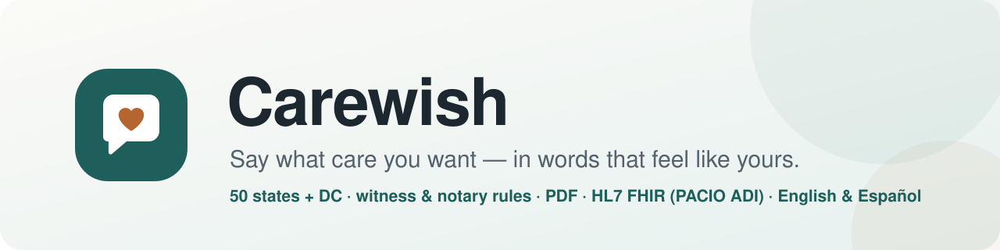
</p>

<p align="center">
  <a href="https://github.com/lobojoel2003/Carewish/actions/workflows/ci.yml"></a>
  <a href="https://github.com/lobojoel2003/Carewish/releases/latest"></a>
  <a href="LICENSE"></a>
  <a href="packages/form-rules/LICENSE"></a>
  <a href="https://hl7.org/fhir/us/pacio-adi/"></a>
  <a href="https://github.com/lobojoel2003/Carewish/pkgs/container/carewish"></a>
  
</p>

**Carewish** walks a person through an advance directive one calm question at a time. It fills in their own state's form, applies that state's witness and notary rules, and exports a printable PDF plus a machine-readable copy a hospital system can load. It also makes a wallet card with a QR code that opens their wishes.

<p align="center">
  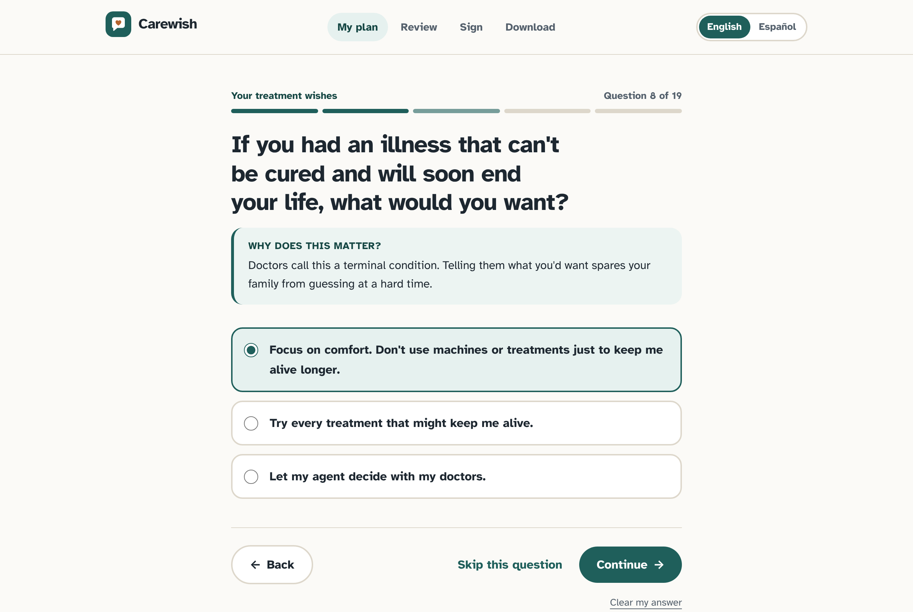
</p>

> [!IMPORTANT]
> Carewish gives legal information, not legal advice. The state rules are compiled from statutes and are still being reviewed state by state ([how to help](CONTRIBUTING.md#1-correct-or-review-a-states-rules)). If a lawyer, a hospital, or a state's official instructions say something different, follow them.

## Contents

- [Why Carewish](#why-carewish)
- [What it does](#what-it-does)
- [Screenshots](#screenshots)
- [Quick start](#quick-start)
- [How it works](#how-it-works)
- [The state rules library](#the-state-rules-library-carewishform-rules)
- [FHIR export](#fhir-export)
- [Privacy and security](#privacy-and-security)
- [Configuration](#configuration)
- [Development](#development)
- [Versions, builds and releases](#versions-builds-and-releases)
- [Contributing](#contributing)
- [License](#license)

## Why Carewish

An advance directive says what medical care you want and who decides for you if you cannot speak. Every U.S. state has its own form and its own signing rules, so people either never start or end up with a document a hospital may not accept.

- **Most people don't have one.** Only **36.7%** of U.S. adults had completed any advance directive, across 150 studies covering 795,909 people. Even among chronically ill adults it was **38.2%** ([Penn PAIR Center, summarizing Health Affairs 2017](https://pair.upenn.edu/publication/approximately-one-in-three-us-adults-completes-any-type-of-advance-directive-for-end-of-life-care/)).
- **The best free tool is closed.** PREPARE for Your Care is free to use but available only in English and Spanish, and organizations that rebrand or redistribute it need a University of California license ([PREPARE FAQ](https://prepareforyourcare.org/faq)). Nobody else can add a language or fix a state form.
- **Other options stop short.** [CaringInfo](https://www.caringinfo.org/planning/advance-directives/by-state/) offers static PDFs with no guidance. [HL7 PACIO ADI](https://github.com/HL7/fhir-pacio-adi/) defines how a directive should travel between health systems, but it is a specification with no patient app. A GitHub search found no maintained builder.

Carewish is open source end to end: the app under the AGPL, and the state rules as a reusable MIT library.

## What it does

|                                        |                                                                                                                                                                                                                                                                                     |
| -------------------------------------- | ----------------------------------------------------------------------------------------------------------------------------------------------------------------------------------------------------------------------------------------------------------------------------------- |
| **One question per screen**            | 19 short questions in everyday words, each with a _why does this matter_ note. Questions about the person who decides for you only appear if you name one.                                                                                                                          |
| **Your state's own form**              | All 50 states and DC. Carewish uses your state's document or documents (for example Texas's _Medical Power of Attorney_ and _Directive to Physicians_), its part titles, and what it calls the decision-maker (_patient advocate_ in Michigan, _health care surrogate_ in Florida). |
| **A signing checklist for your state** | Who can witness, who can't, whether you need a notary, both, or neither, plus special rules such as nursing-home ombudsman witnesses.                                                                                                                                               |
| **A witness checker**                  | Describe the people you plan to ask; Carewish checks them against your state's rules and spots your agent automatically.                                                                                                                                                            |
| **PDF ready to sign**                  | A signing-instructions page, then each state document with witness declarations written from your state's rules, a notary acknowledgment where needed, and an acceptance section where your agent must sign.                                                                        |
| **A copy hospitals can load**          | A FHIR R4 document Bundle following the HL7 PACIO Advance Directive Interoperability guide, validated in CI with the official HL7 validator.                                                                                                                                        |
| **Wallet card with a QR code**         | Print, cut, fold. The code opens an emergency summary, or (with an account) an end-to-end encrypted copy of the full document.                                                                                                                                                      |
| **Private by default**                 | No account needed; answers stay in the browser (IndexedDB). Optional accounts on Postgres are end-to-end encrypted.                                                                                                                                                                 |
| **English and Español**                | i18next from day one, including the rules library's own text. Adding a language is a JSON file.                                                                                                                                                                                     |
| **Accessible**                         | Atkinson Hyperlegible type, large targets, keyboard focus management, dark mode, reduced motion, WCAG 2.1 AA checks in end-to-end tests.                                                                                                                                            |

## Screenshots

<table>
  <tr>
    <td width="50%">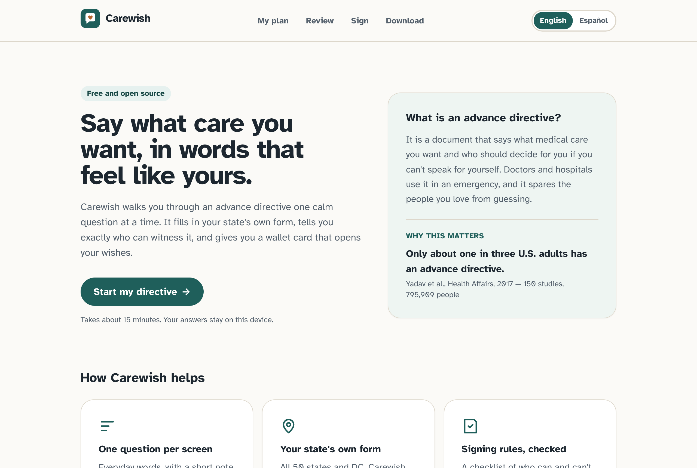<br><sub><b>Home.</b> Start in one click; your answers stay on your device.</sub></td>
    <td width="50%">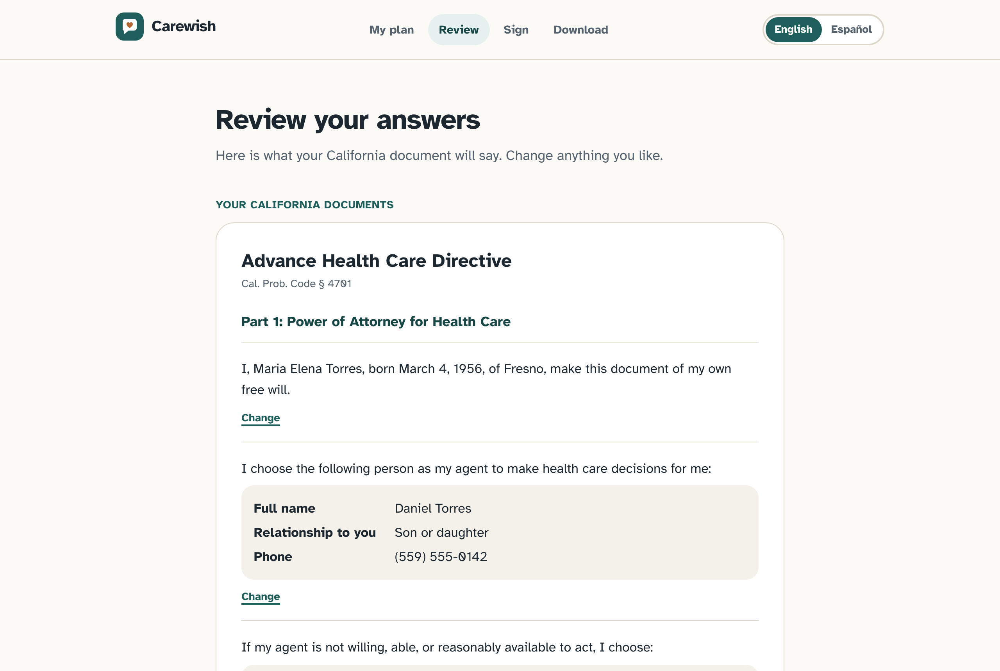<br><sub><b>Review.</b> Your answers laid out in your state's form, part by part.</sub></td>
  </tr>
  <tr>
    <td>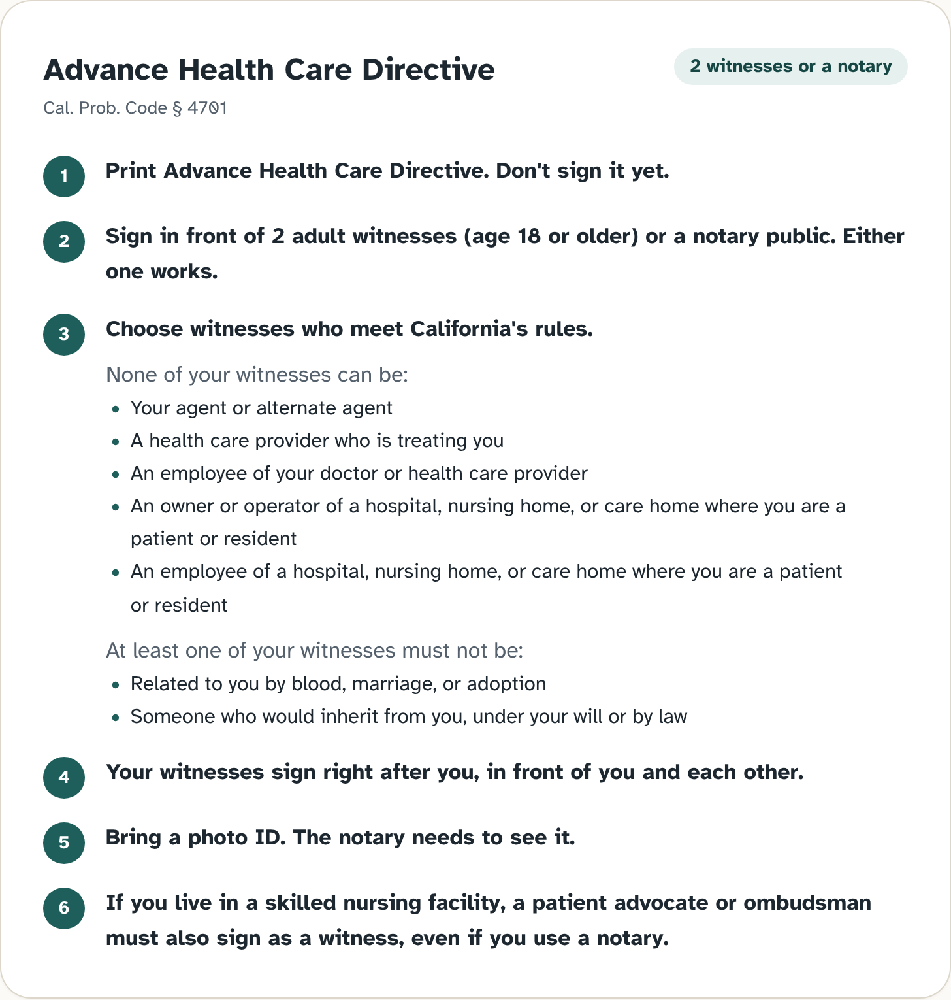<br><sub><b>Signing checklist.</b> Exactly how to sign in your state.</sub></td>
    <td>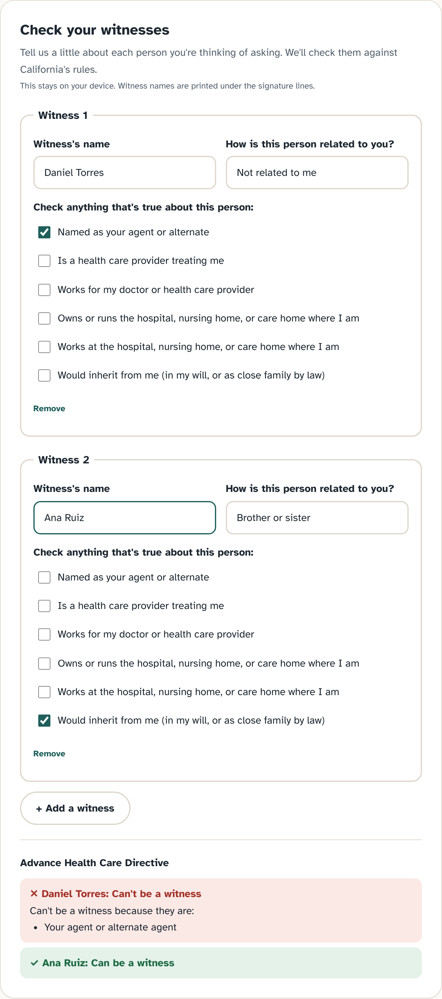<br><sub><b>Witness checker.</b> Your agent can't witness; one relative can.</sub></td>
  </tr>
  <tr>
    <td>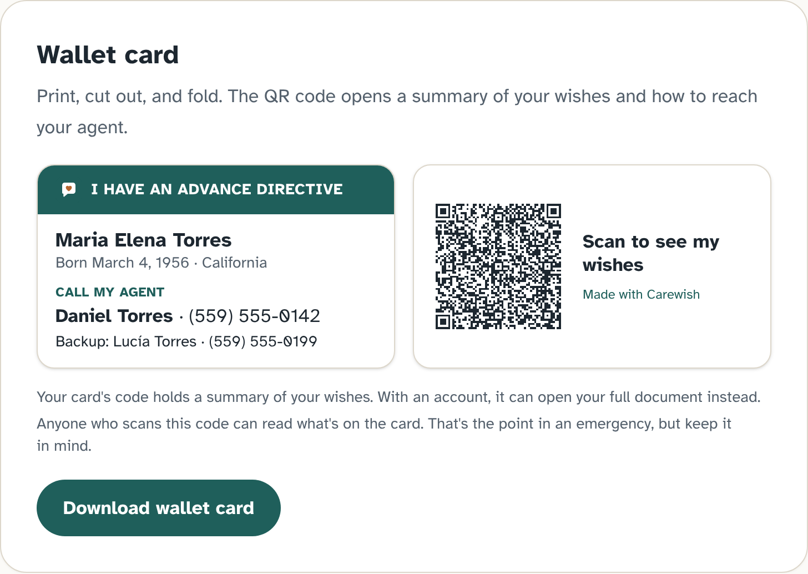<br><sub><b>Wallet card.</b> The QR code opens your wishes.</sub></td>
    <td>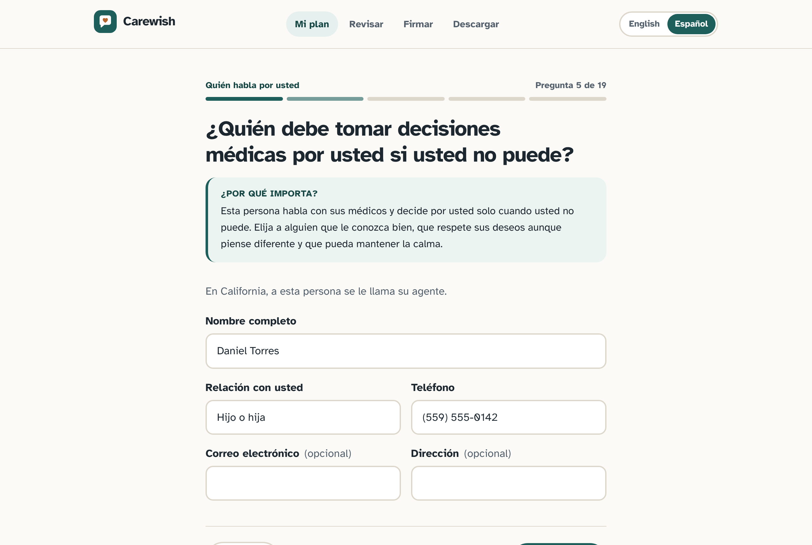<br><sub><b>Español.</b> Every screen, note and rule explanation.</sub></td>
  </tr>
  <tr>
    <td>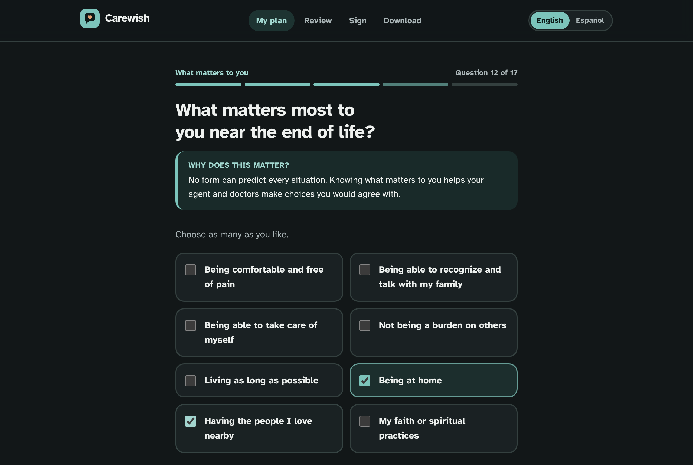<br><sub><b>Dark mode</b> follows your system setting.</sub></td>
    <td align="center">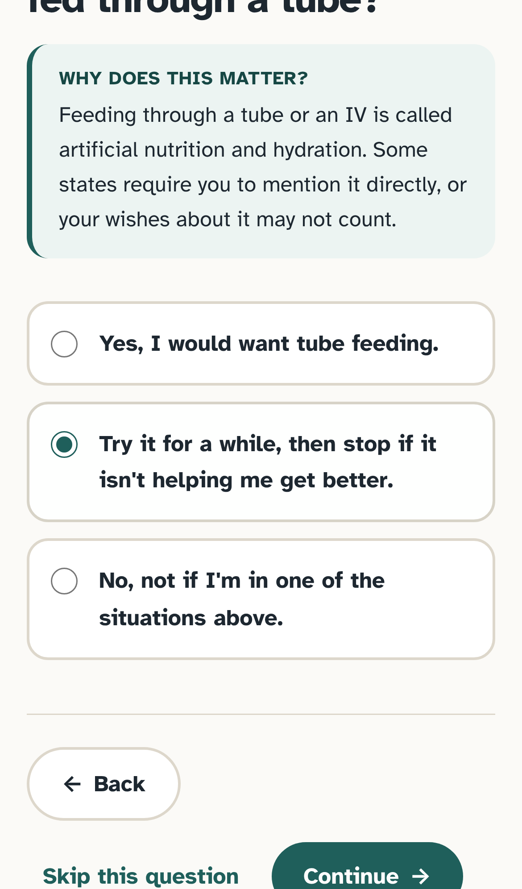<br><sub><b>Phones</b> get the same one-question flow.</sub></td>
  </tr>
</table>

The generated PDF ([example](docs/examples/ca-advance-directive.pdf)) starts with a page of signing instructions you can remove after signing, followed by the state's form:

<p align="center">
  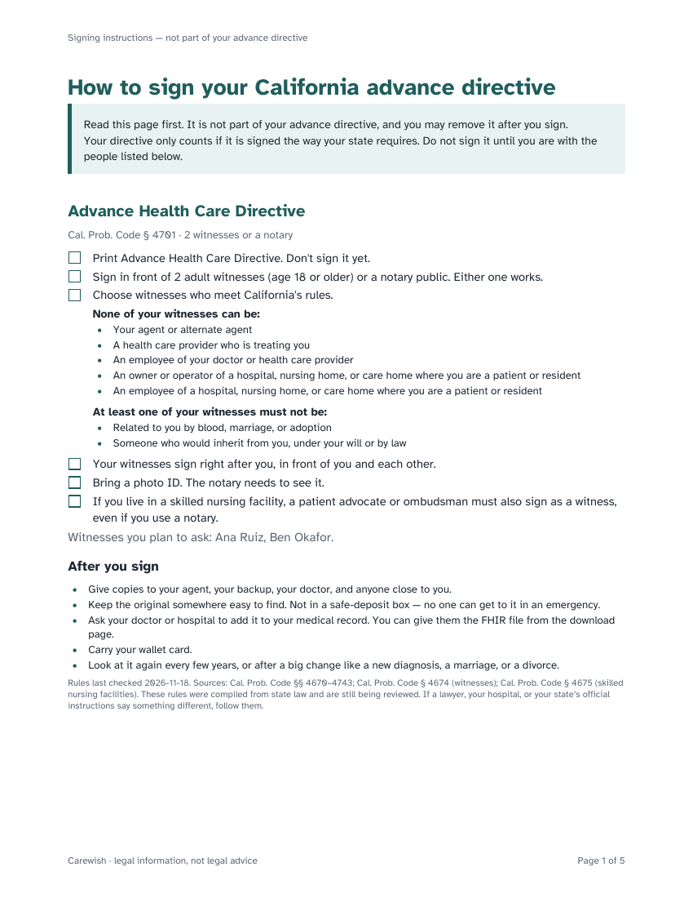
  &nbsp;
  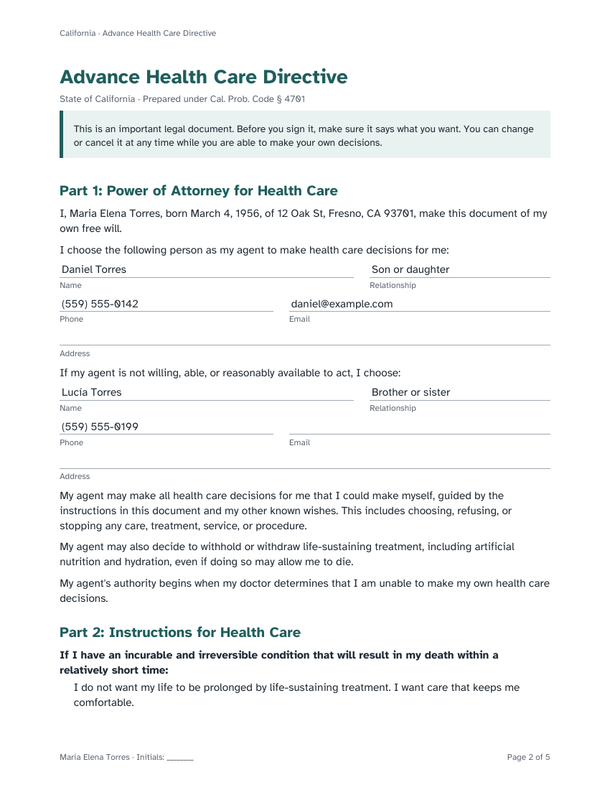
</p>

<p align="center">
  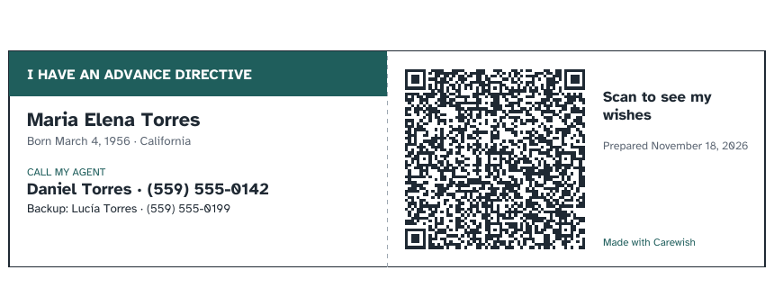<br>
  <sub>The printable wallet card (<a href="docs/examples/ca-wallet-card.pdf">example</a>): cut along the outline and fold along the dashed line.</sub>
</p>

## Quick start

### Docker (recommended)

```bash
docker run -p 3000:3000 ghcr.io/lobojoel2003/carewish:latest
```

Open <http://localhost:3000>. This runs in local-only mode: answers live in the browser.

To turn on optional encrypted accounts and card links, run with Postgres:

```bash
CAREWISH_SECRET=$(openssl rand -hex 32) docker compose up --build
```

### From source

Requires Node.js 22.12+ and pnpm (via Corepack).

```bash
corepack enable
pnpm install
pnpm dev
```

### Prebuilt server

Each [release](https://github.com/lobojoel2003/Carewish/releases) includes `carewish-web-<version>-standalone.tar.gz`, a self-contained Node.js server:

```bash
tar -xzf carewish-web-1.0.0-standalone.tar.gz && node carewish/apps/web/server.js
```

## How it works

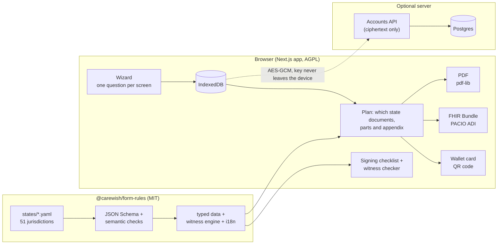

| Path                                         | What lives there                                                                                                                                                      |
| -------------------------------------------- | --------------------------------------------------------------------------------------------------------------------------------------------------------------------- |
| [`packages/form-rules`](packages/form-rules) | MIT library: one YAML file per state, JSON Schema, rule engine, checklists, English and Spanish text.                                                                 |
| [`apps/web`](apps/web)                       | AGPL Next.js 16 app (React 19, TypeScript, Tailwind CSS 4, i18next).                                                                                                  |
| `apps/web/src/lib`                           | Answers model, wizard steps, document planning, statements, [FHIR builder](apps/web/src/lib/fhir/bundle.ts), [PDF writer](apps/web/src/lib/pdf), wallet card, crypto. |
| `apps/web/src/app/api`                       | Optional account, vault and card-link endpoints.                                                                                                                      |
| `apps/web/tests`, `apps/web/e2e`             | Vitest unit tests (with PGlite for Postgres) and Playwright end-to-end tests.                                                                                         |
| [`docs/examples`](docs/examples)             | A sample PDF, FHIR bundle and wallet card for a fictional person.                                                                                                     |

## The state rules library (`@carewish/form-rules`)

Each jurisdiction is one readable YAML file, for example [`states/CA.yaml`](packages/form-rules/states/CA.yaml):

```yaml
code: CA
name: California
terminology:
  agent: agent
documents:
  - id: advance-health-care-directive
    title: Advance Health Care Directive
    kind: combined
    citation: Cal. Prob. Code § 4701
    parts:
      - title: 'Part 1: Power of Attorney for Health Care'
        sections: [principal, agent, alternate-agent, agent-authority]
      - title: 'Part 2: Instructions for Health Care'
        sections: [life-sustaining, nutrition, cpr, pain-relief, values, additional-wishes]
    execution:
      method: witnesses-or-notary
      witnesses:
        count: 2
        minAge: 18
        rules:
          - type: none-may-be
            attributes:
              [agent, healthcare-provider, provider-employee, facility-operator, facility-employee]
          - type: at-least-one-not
            attributes: [relative, heir]
```

```ts
import { requireState, evaluateWitnesses } from '@carewish/form-rules';

const { execution } = requireState('CA').documents[0]!;
evaluateWitnesses(execution, [{ relationship: 'sibling' }, { relationship: 'none' }]).ok; // true
```

See the [library README](packages/form-rules/README.md) for the full API and the attribute vocabulary.

<details>
<summary><b>Coverage: all 50 states and DC</b> (click to expand)</summary>

The same table lives in [`packages/form-rules/STATES.md`](packages/form-rules/STATES.md) and is generated from the YAML files.

| State                | Documents and signing                                                                                                                                              | Decision-maker is called   | Special rules                            |
| -------------------- | ------------------------------------------------------------------------------------------------------------------------------------------------------------------ | -------------------------- | ---------------------------------------- |
| Alabama              | Advance Directive for Health Care — 2 witnesses                                                                                                                    | health care proxy          | —                                        |
| Alaska               | Advance Health Care Directive — 2 witnesses or a notary                                                                                                            | agent                      | —                                        |
| Arizona              | Health Care Power of Attorney — 1 witness or a notary<br>Living Will — 1 witness or a notary                                                                       | agent                      | —                                        |
| Arkansas             | Declaration (Rights of the Terminally Ill or Permanently Unconscious Act) — 2 witnesses                                                                            | health care proxy          | —                                        |
| California           | Advance Health Care Directive — 2 witnesses or a notary                                                                                                            | agent                      | skilled nursing facility                 |
| Colorado             | Medical Durable Power of Attorney — Your signature only (notary recommended)<br>Declaration as to Medical or Surgical Treatment — 2 witnesses (notary recommended) | agent                      | —                                        |
| Connecticut          | Health Care Instructions and Appointment of Health Care Representative — 2 witnesses                                                                               | health care representative | mental health or dds facility            |
| Delaware             | Advance Health-Care Directive — 2 witnesses                                                                                                                        | agent                      | nursing facility                         |
| District of Columbia | Durable Power of Attorney for Health Care — 2 witnesses<br>Declaration (Natural Death Act) — 2 witnesses                                                           | health care agent          | —                                        |
| Florida              | Designation of Health Care Surrogate — 2 witnesses<br>Living Will — 2 witnesses                                                                                    | health care surrogate      | —                                        |
| Georgia              | Georgia Advance Directive for Health Care — 2 witnesses                                                                                                            | health care agent          | —                                        |
| Hawaii               | Advance Health-Care Directive — 2 witnesses or a notary                                                                                                            | agent                      | —                                        |
| Idaho                | Living Will and Durable Power of Attorney for Health Care — Your signature only (notary recommended)                                                               | agent                      | —                                        |
| Illinois             | Illinois Statutory Short Form Power of Attorney for Health Care — 1 witness                                                                                        | agent                      | —                                        |
| Indiana              | Indiana Advance Directive for Health Care Decisions — 2 witnesses or a notary                                                                                      | health care representative | —                                        |
| Iowa                 | Durable Power of Attorney for Health Care — 2 witnesses or a notary<br>Declaration (Living Will) — 2 witnesses or a notary                                         | health care agent          | —                                        |
| Kansas               | Durable Power of Attorney for Health Care Decisions — 2 witnesses or a notary<br>Declaration (Living Will) — 2 witnesses                                           | agent                      | —                                        |
| Kentucky             | Living Will Directive — 2 witnesses or a notary                                                                                                                    | health care surrogate      | —                                        |
| Louisiana            | Declaration Concerning Life-Sustaining Procedures — 2 witnesses                                                                                                    | representative             | —                                        |
| Maine                | Advance Health-Care Directive — 2 witnesses                                                                                                                        | agent                      | —                                        |
| Maryland             | Maryland Advance Directive: Planning for Future Health Care Decisions — 2 witnesses                                                                                | health care agent          | —                                        |
| Massachusetts        | Massachusetts Health Care Proxy — 2 witnesses                                                                                                                      | health care agent          | —                                        |
| Michigan             | Patient Advocate Designation — 2 witnesses                                                                                                                         | patient advocate           | agent must accept, mental health program |
| Minnesota            | Health Care Directive — 2 witnesses or a notary                                                                                                                    | health care agent          | —                                        |
| Mississippi          | Advance Health-Care Directive — 2 witnesses or a notary                                                                                                            | agent                      | —                                        |
| Missouri             | Durable Power of Attorney for Health Care — Notary<br>Health Care Declaration — 2 witnesses                                                                        | health care agent          | —                                        |
| Montana              | Declaration (Montana Rights of the Terminally Ill Act) — 2 witnesses                                                                                               | health care agent          | —                                        |
| Nebraska             | Power of Attorney for Health Care — 2 witnesses or a notary<br>Declaration (Rights of the Terminally Ill Act) — 2 witnesses or a notary                            | health care agent          | —                                        |
| Nevada               | Durable Power of Attorney for Health Care Decisions — 2 witnesses or a notary<br>Declaration (Living Will) — 2 witnesses                                           | agent                      | —                                        |
| New Hampshire        | Advance Directive — 2 witnesses or a notary                                                                                                                        | agent                      | —                                        |
| New Jersey           | Advance Directive for Health Care — 2 witnesses or a notary                                                                                                        | health care representative | —                                        |
| New Mexico           | Optional Advance Health-Care Directive — Your signature only (notary recommended)                                                                                  | agent                      | —                                        |
| New York             | New York Health Care Proxy — 2 witnesses<br>Living Will — 2 witnesses                                                                                              | health care agent          | mental hygiene facility                  |
| North Carolina       | Health Care Power of Attorney — 2 witnesses and a notary<br>Advance Directive for a Natural Death ("Living Will") — 2 witnesses and a notary                       | health care agent          | —                                        |
| North Dakota         | Health Care Directive — 2 witnesses or a notary                                                                                                                    | health care agent          | —                                        |
| Ohio                 | Health Care Power of Attorney — 2 witnesses or a notary<br>Living Will Declaration — 2 witnesses or a notary                                                       | health care agent          | —                                        |
| Oklahoma             | Advance Directive for Health Care — 2 witnesses                                                                                                                    | health care proxy          | —                                        |
| Oregon               | Advance Directive for Health Care — 2 witnesses                                                                                                                    | health care representative | agent must accept                        |
| Pennsylvania         | Durable Health Care Power of Attorney and Health Care Treatment Instructions (Living Will) — 2 witnesses                                                           | health care agent          | —                                        |
| Rhode Island         | Durable Power of Attorney for Health Care — 2 witnesses and a notary<br>Declaration (Rights of the Terminally Ill Act) — 2 witnesses                               | agent                      | —                                        |
| South Carolina       | Health Care Power of Attorney — 2 witnesses<br>Declaration of a Desire for a Natural Death — 2 witnesses and a notary                                              | health care agent          | —                                        |
| South Dakota         | Durable Power of Attorney for Health Care — 2 witnesses and a notary<br>Living Will Declaration — 2 witnesses (notary recommended)                                 | agent                      | —                                        |
| Tennessee            | Advance Directive for Health Care — 2 witnesses or a notary                                                                                                        | agent                      | —                                        |
| Texas                | Medical Power of Attorney — 2 witnesses or a notary<br>Directive to Physicians and Family or Surrogates — 2 witnesses or a notary                                  | agent                      | —                                        |
| Utah                 | Utah Advance Health Care Directive — 1 witness                                                                                                                     | agent                      | —                                        |
| Vermont              | Advance Directive — 2 witnesses                                                                                                                                    | agent                      | facility explanation                     |
| Virginia             | Advance Medical Directive — 2 witnesses                                                                                                                            | agent                      | —                                        |
| Washington           | Durable Power of Attorney for Health Care — 2 witnesses or a notary<br>Health Care Directive — 2 witnesses                                                         | agent                      | —                                        |
| West Virginia        | Combined Medical Power of Attorney and Living Will — 2 witnesses and a notary                                                                                      | representative             | —                                        |
| Wisconsin            | Power of Attorney for Health Care — 2 witnesses<br>Declaration to Physicians (Wisconsin Living Will) — 2 witnesses                                                 | health care agent          | —                                        |
| Wyoming              | Advance Health Care Directive — 2 witnesses or a notary                                                                                                            | agent                      | —                                        |

</details>

## FHIR export

The **Download** page exports a FHIR R4 `Bundle` of type `document`, following the [HL7 PACIO Advance Directive Interoperability IG, STU 1](https://hl7.org/fhir/us/pacio-adi/STU1/) (`hl7.fhir.us.pacio-adi#1.0.0`). See the [example bundle](docs/examples/ca-advance-directive.fhir.json).

| Resource        | Profile                                                                                        | Holds                                                                                                                                                                                           |
| --------------- | ---------------------------------------------------------------------------------------------- | ----------------------------------------------------------------------------------------------------------------------------------------------------------------------------------------------- |
| `Composition`   | ADI-PACPComposition (LOINC 81334-5)                                                            | Sections for healthcare agent (81335-2), care experience (81338-6), certain health conditions (81336-0), upon death (81337-8), witnesses and notary (81339-4); jurisdiction extension (`US-CA`) |
| `Patient`       | US Core Patient                                                                                | Name, birth date, address, preferred language, primary physician                                                                                                                                |
| `RelatedPerson` | ADI-Participant                                                                                | Primary and alternate healthcare agents                                                                                                                                                         |
| `Consent`       | ADI-ParticipantConsent                                                                         | Powers granted (75786-4), with a nested _deny_ when the person keeps life-sustaining decisions for themselves                                                                                   |
| `CarePlan`      | ADI-PreferenceCarePlan                                                                         | One plan per situation (terminal, permanently unconscious, end-stage)                                                                                                                           |
| `Observation`   | ADI-PersonalInterventionPreference, ADI-CareExperiencePreference, ADI-OrganDonationObservation | Treatment wishes, values, faith and traditions, organ donation                                                                                                                                  |
| `Organization`  | US Core Organization                                                                           | Custodian (a patient-held document)                                                                                                                                                             |

Every narrative is generated and HTML-escaped, references resolve inside the bundle (`urn:uuid:`), and the CI job **FHIR validation** runs the official HL7 validator against sample bundles for six states.

The validation report fails CI on any error. One error is expected and listed separately: STU 1 defines the `HCA-section-entries` invariant as `$this.resolve() is relatedPerson` (lowercase), which can never match a `RelatedPerson`. The IG's current source fixes it to `is RelatedPerson`. Carewish's healthcare-agent section contains the Consent and RelatedPerson entries that invariant is meant to require. The remaining output is warnings, mostly terminology checks that need a terminology server.

## Privacy and security

- **Nothing leaves the device by default.** Answers are stored in the browser's IndexedDB. There are no analytics, ads or trackers.
- **Accounts are end-to-end encrypted.** The password is stretched in the browser with PBKDF2-SHA-256 (600,000 iterations), then split with HKDF into a login key and a non-extractable AES-256-GCM vault key. The server stores ciphertext and a scrypt hash of the login key, never the password. Passwords can't be reset, and the app says so.
- **Card links** store a document encrypted with a random key that exists only in the QR code's URL fragment (`#k=…`), which browsers never send to a server.
- **Cards without an account** carry a compressed summary in the fragment, readable by whoever scans the card, which is the point in an emergency.
- **Hardening:** strict Content Security Policy, `frame-ancestors 'none'`, `Referrer-Policy: no-referrer`, HSTS, `HttpOnly; SameSite=Strict` session cookies with hashed tokens, Origin checks on writes, rate-limited sign-in that doesn't reveal which emails exist, input size limits, and optimistic concurrency for sync. See [SECURITY.md](SECURITY.md).

## Configuration

All settings are environment variables ([`.env.example`](.env.example)):

| Variable                                                                 | Default           | Purpose                                                                                                 |
| ------------------------------------------------------------------------ | ----------------- | ------------------------------------------------------------------------------------------------------- |
| `DATABASE_URL`                                                           | unset             | Postgres connection string. When set, accounts and card links turn on and migrations run automatically. |
| `CAREWISH_SECRET`                                                        | —                 | Required with `DATABASE_URL` (32+ characters). Derives decoy sign-in parameters.                        |
| `DATABASE_SSL`, `DATABASE_SSL_REJECT_UNAUTHORIZED`, `DATABASE_POOL_SIZE` | off, `true`, `10` | Postgres TLS and pool size.                                                                             |
| `NEXT_PUBLIC_SITE_URL`                                                   | browser origin    | Public URL printed in wallet-card QR codes.                                                             |
| `PORT`, `HOSTNAME`                                                       | `3000`, `0.0.0.0` | Server address (Docker).                                                                                |

Health check: `GET /api/health` returns `{ status, version, build, commit, accounts, database }`.

## Development

```bash
pnpm dev              # app on http://localhost:3000 (builds the rules library first)
pnpm test             # unit tests: rules library + app (PGlite stands in for Postgres)
pnpm test:coverage    # with coverage thresholds
pnpm build            # library (tsup) + app (Next.js standalone)
pnpm test:e2e         # Playwright: wizard, PDF/FHIR/card downloads, Spanish, WCAG checks, mobile
pnpm lint && pnpm typecheck && pnpm format:check
pnpm samples          # example PDFs, FHIR bundles and wallet cards in apps/web/samples
```

End-to-end account tests run when `DATABASE_URL` points at a Postgres database (CI provides one). Regenerate README screenshots with `SCREENSHOTS=1 pnpm --filter @carewish/web exec playwright test e2e/screenshots.spec.ts`.

**Continuous integration** ([`ci.yml`](.github/workflows/ci.yml)) runs on every push and pull request:

| Job                  | Checks                                                                                             |
| -------------------- | -------------------------------------------------------------------------------------------------- |
| Lint, format & types | State rules validate against the schema, Prettier, ESLint, TypeScript                              |
| Unit tests           | Node 22 and 24, with coverage                                                                      |
| Build                | Builds everything, packs the library, and installs it in a fresh project (CJS and ESM)             |
| End-to-end           | Playwright on Chromium (desktop and phone) against Postgres 17, including axe accessibility checks |
| FHIR validation      | Official HL7 validator against PACIO ADI 1.0.0                                                     |
| Docker image         | Builds the image and smoke-tests the running container                                             |

[CodeQL](.github/workflows/codeql.yml) scans the code weekly, and [Dependabot](.github/dependabot.yml) keeps dependencies and actions current.

## Versions, builds and releases

- **Semantic versioning.** The app and the library share one version (currently **1.0.0**), recorded in every `package.json` and in [CHANGELOG.md](CHANGELOG.md).
- **Build numbers.** Every CI build stamps the version, the GitHub Actions run number and the commit into the app. They appear in the footer (`v1.0.0 (build 42)`), on the About page, in `/api/health`, in PDF metadata, and as OCI labels on the Docker image.
- **Automatic releases.** After CI passes on `main`, the [Release workflow](.github/workflows/release.yml) checks whether the version in `package.json` has a tag. If not, it:
  1. creates the annotated tag `vX.Y.Z`,
  2. publishes a GitHub Release with notes from the changelog and these files: the standalone server, the npm package tarball, the state YAML bundle, sample outputs and `SHA256SUMS.txt`, all with signed build-provenance attestations,
  3. pushes a multi-arch (amd64 and arm64) image with SBOM and provenance to `ghcr.io/lobojoel2003/carewish` tagged `X.Y.Z`, `X.Y`, `X`, `latest` and `sha-<commit>`,
  4. optionally publishes `@carewish/form-rules` to npm with provenance (set the `PUBLISH_NPM` variable and `NPM_TOKEN` secret).

To cut a release:

```bash
pnpm version:bump minor   # or patch, major, or an exact version like 1.2.0
```

Then describe the changes in CHANGELOG.md and merge to `main`.

## Contributing

Corrections to state rules, new languages and code are all welcome. Read [CONTRIBUTING.md](CONTRIBUTING.md) and our [code of conduct](CODE_OF_CONDUCT.md). Rule corrections need a source; use the **State rule correction** issue template. Please never include real personal or medical information in issues, code or screenshots.

## License

- The Carewish app (`apps/web`, and the repository as a whole unless noted) is licensed under the [GNU Affero General Public License v3.0](LICENSE). If you run a modified version as a service, you must offer its source to its users.
- The state rules library (`packages/form-rules`) is licensed under the [MIT License](packages/form-rules/LICENSE), so anyone can reuse the rules.
- Atkinson Hyperlegible is © Braille Institute of America, licensed under the [SIL Open Font License 1.1](apps/web/public/fonts/OFL.txt).
- LOINC® codes in the FHIR export are © Regenstrief Institute, Inc., used under the LOINC license. SNOMED CT® codes are used per the SNOMED International license terms for U.S. users.
